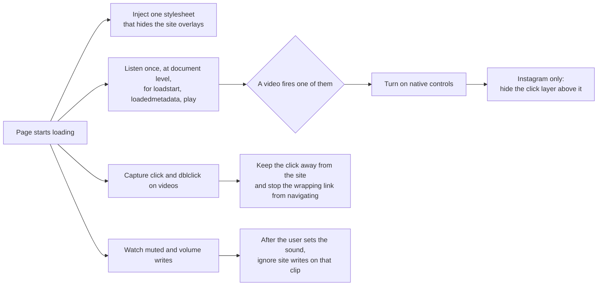

<div align="center">


# DNA Social Media Plus

**Real video controls on social media feeds.**

A userscript that removes the custom video overlays on 9GAG, NSFW.com and Instagram and gives every clip the browser's own player: play, pause, seek, elapsed time, volume, playback speed, picture-in-picture and fullscreen.

[](https://github.com/LastRoze/DNA-Social-Media-Plus/raw/master/DNA-Social-Media-Plus.user.js)
[](https://github.com/LastRoze/DNA-Social-Media-Plus/raw/master/DNA-Social-Media-Plus.user.js)
[](DNA-Social-Media-Plus.user.js)
[](DNA-Social-Media-Plus.user.js)

[](https://9gag.com)
[](https://nsfw.com)
[](https://www.instagram.com)
[](https://www.tampermonkey.net)
[](https://violentmonkey.github.io)
[](https://github.com/LastRoze/DNA-Social-Media-Plus/actions/workflows/checks.yml)
[](https://github.com/LastRoze/DNA-Social-Media-Plus/commits/master)
[](https://github.com/LastRoze/DNA-Social-Media-Plus/issues)

[Install](#install) - [Sites](#supported-sites) - [Features](#features) - [How it works](#how-it-works) - [Performance](#performance) - [FAQ](#faq) - [Development](#development) - [Changelog](#changelog)

</div>

---

## Why

Social feeds wrap every video in their own player. The site decides when sound plays, hides the timeline, and turns a click on the video into "open this post". DNA Social Media Plus hands the video back to you.

| Without the script | With the script |
| :-- | :-- |
| A big "Play" badge sits on paused 9GAG clips | No badge, the native play button is in the control bar |
| 9GAG shows only a frozen length label (`0:15`) | Live elapsed time and duration (`0:06 / 0:15`) with a seek bar |
| Sound is a single site toggle in the corner | Native mute button and volume slider |
| A click on the video opens the post in a new tab (9GAG) or the media viewer (NSFW.com) | A click plays or pauses, the page stays where it is |
| Instagram covers the video with an invisible layer, so nothing is reachable | The layer is gone and the native controls work |
| The site re-mutes the clip when you seek | Once you set the sound yourself, the site cannot change it on that clip |
| No speed control, no picture-in-picture | Playback speed and picture-in-picture from the native menu |

## Install

1. Install a userscript manager.

   | Browser | Manager |
   | :-- | :-- |
   | Chrome, Edge, Brave, Opera, Vivaldi | [Tampermonkey](https://www.tampermonkey.net) or [Violentmonkey](https://violentmonkey.github.io) |
   | Firefox | [Tampermonkey](https://addons.mozilla.org/firefox/addon/tampermonkey/) or [Violentmonkey](https://addons.mozilla.org/firefox/addon/violentmonkey/) |
   | Safari (macOS) | [Tampermonkey](https://www.tampermonkey.net/?browser=safari) or [Userscripts](https://apps.apple.com/app/userscripts/id1463298887) |

2. Open **[DNA-Social-Media-Plus.user.js](https://github.com/LastRoze/DNA-Social-Media-Plus/raw/master/DNA-Social-Media-Plus.user.js)** and press **Install** in the manager's dialog.

3. Reload any open 9GAG, NSFW.com or Instagram tab.

Updates are automatic. The manager polls [`DNA-Social-Media-Plus.meta.js`](DNA-Social-Media-Plus.meta.js) and pulls the new script when `@version` goes up.

> **Coming from v1.0?** It pointed its update check at files that no longer existed, so it never updated. Version 1.1 publishes those old paths again, so the next update check moves you onto this script.
>
> **Coming from the old "DNA 9GAG Plus" (2.0)?** That script's version line is higher than this one, so it will not update by itself. Install from the link above and remove the old entry.

## Supported sites

| Site | Pages | Removed | What you get |
| :-- | :-- | :-- | :-- |
| **9GAG** (`9gag.com`, any subdomain) | Home, Hot, Trending, Fresh, sections, tags, single posts | "Play" badge, length label, sound toggle | Native controls; a click on the video no longer opens the post |
| **NSFW.com** (`nsfw.com`, any subdomain) | Feed, single posts | "View media" click layer, mute/unmute button | Native controls; a click on the video no longer opens the media viewer or the post |
| **Instagram** (`instagram.com`) | Reels and posts with video | The transparent click layer and the custom volume slider | Native controls on top of the clip |

NSFW.com is run by the 9GAG team and uses the same media pipeline, so both sites get the same treatment.

## Features

| Feature | Detail |
| :-- | :-- |
| **Native controls on every video** | Play and pause, seek bar, elapsed and total time, volume, mute, fullscreen, playback speed, picture-in-picture, download where the browser offers it |
| **Site overlays hidden** | Hidden with one stylesheet, so they stay hidden when the site re-renders them |
| **Clicks stay on the video** | A click on a video is kept away from the site, so it no longer opens the post. Links around the video (title, comments, middle-click to open in a new tab) still work |
| **Your sound choice sticks** | After you mute, unmute or change the volume of a clip yourself, the site's own code can no longer change it on that clip |
| **Instant** | Runs at `document-start`, so controls are on before the first frame and overlays never flash |
| **Responsive** | Works on desktop and phone layouts; the native controls scale with the video |
| **Lightweight** | Under 5 KB, no libraries, no timers, no polling, no DOM observers |
| **SPA-aware** | Infinite scroll and in-app navigation are covered with no extra work, because the script reacts to video events, not to page loads |

## How it works



| Piece | Mechanism | Why this way |
| :-- | :-- | :-- |
| Overlay hiding | One `<style>` element with site-specific selectors | CSS costs nothing per frame and survives framework re-renders. v1.0 deleted the nodes once, and 9GAG's Vue app simply put them back |
| Turning on controls | Capture-phase listeners for `loadstart`, `loadedmetadata` and `play` on `document` | Media events do not bubble, but they can be captured. Every video fires them, including ones added by infinite scroll, so there is no need to watch the DOM |
| Click isolation | Capture-phase `click` and `dblclick` on `window`, `stopPropagation()` when the target is a video with controls | The site's handlers never see the click, while the browser's controls still act on it. When the video sits inside a link (9GAG), the link's `href` is lifted for that one click so it cannot navigate |
| Sound guard | Wrapped `muted` and `volume` setters on `HTMLMediaElement.prototype`, plus a `volumechange` listener | Native controls change the sound without going through page JavaScript. A change that no page script made is the user's, and from then on page writes to that clip are ignored |
| Instagram layer | Walks up to 12 ancestors from the video and hides the sibling `role="group"` layer that holds a `role="presentation"` child | Instagram's class names are generated and its labels are translated, but these ARIA roles stay the same in every language |

## Performance

| Concern | v1.0 | v1.1 |
| :-- | :-- | :-- |
| Script size | 2.9 KB plus jQuery 3.1.1 (about 85 KB) from a Google CDN | 4.8 KB, no `@require` |
| Network requests at page load | 1 (jQuery) | 0 |
| DOM observer | `MutationObserver` on the whole `body`, scanning every video on every insertion | None |
| Scroll handler | Debounced `scroll` listener that re-scanned the page | None |
| Work per new video | Full-page jQuery scan | One property write when the video fires its first event |
| Work per click | None | One `instanceof` check |
| Memory | Marker attributes on every video | `WeakMap` and `WeakSet` entries that are freed with the video |

## Compatibility

| Environment | Status |
| :-- | :-- |
| Chrome 157, script injected at document start | Verified on 9GAG (feed and post), NSFW.com (feed and post) and Instagram (reel page). 9GAG and NSFW.com also verified at a 400 px phone viewport |
| Edge, Brave, Opera, Vivaldi | Expected to match Chrome (same engine), not separately tested |
| Firefox | Expected to work; the controls are Firefox's own design. Not separately tested |
| Safari | Expected to work with Tampermonkey or Userscripts. Not separately tested |
| Instagram while signed in | Not tested: testing ran signed out, which covers reel pages on desktop only. The signed-in home feed and the phone layout may need a selector update |

## FAQ

<details>
<summary><b>The controls do not show up.</b></summary>

1. Check that the manager lists the script as enabled for the site.
2. Reload the tab. The script has to start before the page does.
3. Check that no other script or extension sets `controls` back to `false` or hides `<video>` controls with CSS.
4. Still broken? [Open an issue](https://github.com/LastRoze/DNA-Social-Media-Plus/issues) with the page URL and your browser and manager versions.

</details>

<details>
<summary><b>How do I open a post now that a click on the video plays it?</b></summary>

Click the post title, the comment count or the timestamp. Middle-click on the video still opens the post in a new tab on 9GAG.

</details>

<details>
<summary><b>Why is the video muted when it starts?</b></summary>

Browsers only allow autoplay without sound. The site starts muted; press the native speaker icon once and the site cannot mute that clip again.

</details>

<details>
<summary><b>Will this get my account flagged?</b></summary>

The script makes no requests, reads no account data and sends nothing anywhere. It changes how videos on the page you are viewing are displayed.

</details>

<details>
<summary><b>Can you add another site?</b></summary>

Open an issue with a link to a public page that shows the problem. Each site is one entry in the `SITES` table at the top of the script.

</details>

## Development

```
DNA-Social-Media-Plus/
|-- DNA-Social-Media-Plus.user.js   the script (edit this one)
|-- DNA-Social-Media-Plus.meta.js   generated: metadata block for update checks
|-- 9GAG-Plus.user.js               generated: copy for installs from the 9GAG Plus era
|-- 9GAG-Plus.meta.js               generated: copy for installs from the 9GAG Plus era
|-- scripts/build.mjs               writes the generated files, --check verifies them
|-- scripts/text-lint.ts            text hygiene lint for PR titles and bodies
`-- .github/workflows/checks.yml    CI: syntax, generated files, PR text hygiene
```

### Add a site

Add an entry to `SITES` in [`DNA-Social-Media-Plus.user.js`](DNA-Social-Media-Plus.user.js):

| Field | Required | Meaning |
| :-- | :-: | :-- |
| `host` | yes | Regular expression tested against `location.hostname` |
| `css` | yes | Rules that hide the site's overlay elements (use `''` when there are none) |
| `overlay` | no | `(video) => Element \| null`, for overlays that CSS cannot target; the returned element is hidden |

Then add a matching `// @match` line to the header.

### Release

1. Edit `DNA-Social-Media-Plus.user.js` and raise `@version` by one step: `1.1`, `1.2` ... `1.9`, then `2.0`, `2.1` and so on. The format is always `MAJOR.MINOR` with a single-digit minor; `node scripts/build.mjs --check` rejects anything else.
2. Run `node scripts/build.mjs` to regenerate the `.meta.js` file and the legacy copies.
3. Open a pull request. CI checks the syntax, checks that the generated files are current, and lints the PR title and body.
4. Merge to `master`. Installed copies update on their next check.

## Changelog

| Version | Changes |
| :-- | :-- |
| **1.1** | Added NSFW.com. Fixed the 9GAG "Play" badge, length label and sound toggle coming back after re-renders. Fixed clicks on 9GAG videos opening the post in a new tab, and clicks on NSFW.com videos opening the viewer. Fixed Instagram, where an invisible layer covered the controls. Stopped sites from re-muting a clip after the user unmuted it. Fixed update checks that pointed at deleted files. Removed jQuery, the scroll handler and the `MutationObserver`. Started at `document-start`. |
| 1.0 | First DNA Social Media Plus release: 9GAG and Instagram. |
| 2.0 (DNA 9GAG Plus) | Last release of the old 9GAG-only script, on its own version line. |

## Credits

Made by [Last Roze](https://github.com/LastRoze) - [lastroze.github.io](https://lastroze.github.io/).

Copyright (c) 2020 - 2026 Yoga Budiman.
